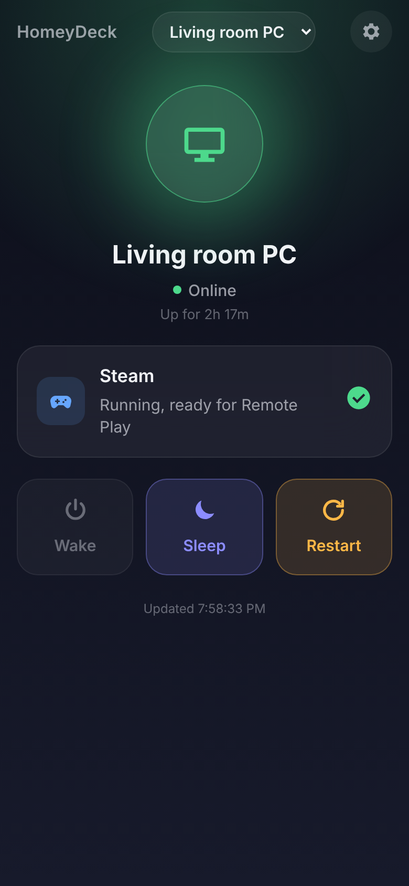
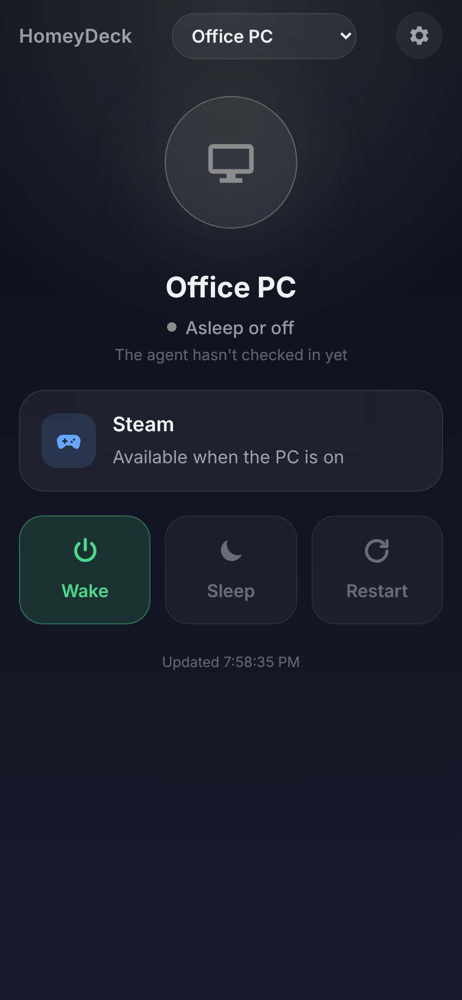
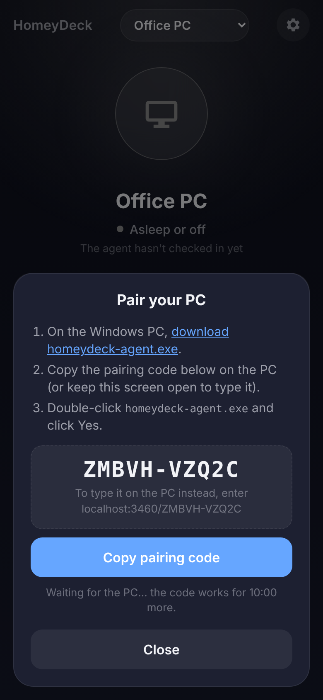
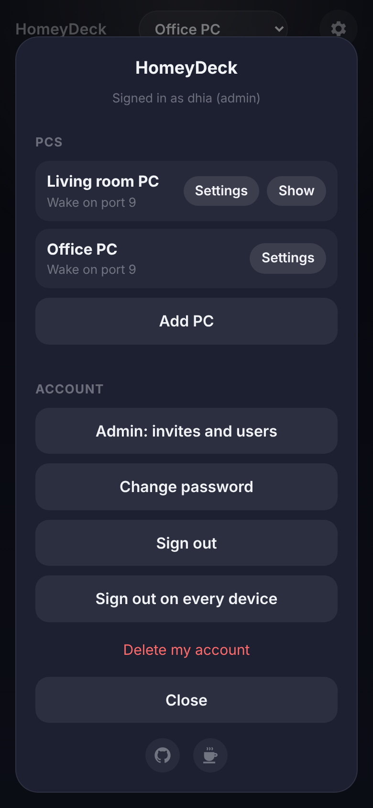

# HomeyDeck

Wake, check and control your Windows gaming PC from your phone or Mac, from anywhere. Made for Steam Remote Play.

- **Wake** the PC with Wake-on-LAN through your router's DDNS address
- **See** whether it's on, how long it's been up, and whether Steam is running
- **Launch Steam** so it's ready for Remote Play
- **Sleep** or **restart** it remotely

HomeyDeck is an installable web app with accounts. Each person signs in with a username and password, pairs their own PCs (up to 3), and enters their own wake details. New accounts need an invite code from the admin.

Everything runs on free plans with no card: Vercel Hobby for the server and app, and Upstash Redis (added from Vercel) for a little state.

<p align="center">
  
  
  
  
</p>

[](https://vercel.com/new/clone?repository-url=https%3A%2F%2Fgithub.com%2FOunissiDhiaEddine%2FHomeyDeck%2Ftree%2Fmain%2Fweb&project-name=homeydeck&repository-name=homeydeck&env=ADMIN_USERNAME,ADMIN_PASSWORD&envDescription=The%20username%20and%20password%20for%20your%20HomeyDeck%20admin%20account&envLink=https%3A%2F%2Fgithub.com%2FOunissiDhiaEddine%2FHomeyDeck%2Fblob%2Fmain%2Fdocs%2Fself-hosting.md%232-choose-your-admin-login)

**Host your own:** [docs/self-hosting.md](docs/self-hosting.md) walks through it with no terminal.

## Using HomeyDeck

1. Open the HomeyDeck site, tap **Have an invite code? Create an account**, and enter your invite code, a username and a password.
2. Install it as an app: on iPhone, Safari → **Share → Add to Home Screen**; on Mac, Safari → **File → Add to Dock**.
3. Tap **Add PC**, enter the PC's MAC address, your router's DDNS name and the UDP port it forwards (or leave them blank for now), and tap **Next**.
4. On the Windows PC, download [`homeydeck-agent.exe`](https://github.com/OunissiDhiaEddine/HomeyDeck/releases/latest/download/homeydeck-agent.exe), copy the pairing code, then double-click the exe and click **Yes**. Without a copied code it asks you to type it.

[docs/self-hosting.md](docs/self-hosting.md#7-prepare-the-pc-and-router-for-wake-on-lan) explains the Windows and router settings Wake-on-LAN needs.

To **remove** the agent, use Windows **Settings → Apps → HomeyDeck agent → Uninstall**, double-click the exe again, or remove the PC in HomeyDeck. Each way stops it, removes it from startup and deletes `%LOCALAPPDATA%\HomeyDeck`. To **update** it, double-click a newer exe and click **Yes**.

## How it works

```
 HomeyDeck app (PWA) ──HTTPS──▶ Vercel ◀──HTTPS polling── Windows agent
                                  │                         (hidden, on the PC)
                                  └──UDP magic packet──▶ router DDNS:port ──▶ PC network card
```

- **`web/`**: the Vercel project. `public/` is the installable web app, `api/` the server functions, and `lib/` their shared code. There is no build step and there are no dependencies.
- **`agent/`**: a small Go program for Windows. It starts hidden at sign-in, asks the server for work every 30 seconds (every 2 seconds while someone is using the app), reports Steam status, and carries out launch / sleep / restart. It never accepts inbound connections. One released exe works with any HomeyDeck server, because the pairing code carries the server's address.

### Configuration

All configuration is in Vercel environment variables. `/api/health` reports which are set, never their values.

| Name | Needed | What it does |
|---|---|---|
| `KV_REST_API_URL`, `KV_REST_API_TOKEN` | yes | Added by Vercel when you connect Upstash Redis. `UPSTASH_REDIS_REST_URL` / `_TOKEN` also work. |
| `DATA_KEY` | yes | 32+ random characters. Encrypts each PC's MAC address and DDNS name. To rotate it, move the old value to `DATA_KEY_PREVIOUS`. |
| `ADMIN_USERNAME` | yes | The admin's username. |
| `ADMIN_PASSWORD` | first sign-in only | Creates the admin account the first time it signs in. Delete it afterwards. |
| `MAX_PCS_PER_USER` | no | PCs per account, 3 by default. `0` means no limit. |
| `AGENT_DOWNLOAD_URL` | no | Where the app links for `homeydeck-agent.exe`. Defaults to this repo's latest release. |

## Security

- Passwords are hashed with scrypt (N=2^15, r=8, p=1, a random salt per user). Session, agent and invite tokens are random and stored only as SHA-256 hashes.
- Sessions are `HttpOnly; Secure; SameSite=Lax` cookies that last 30 days from last use. Changing your password signs out your other devices.
- Every request that changes something must be JSON from the site's own origin, which blocks cross-site requests.
- Every PC's keys are scoped to its owner's account and to a hash of its agent's secret, so one account can't see, wake or command another's PCs. The tests check this.
- MAC addresses and DDNS names are encrypted with AES-256-GCM using `DATA_KEY`, so the database alone reveals no home addresses.
- The agent only accepts three commands (`launch_steam`, `sleep`, `reboot`). There's no remote shell. A command it doesn't pick up within 90 seconds is dropped, so a restart can never run hours later.
- On the PC, the agent's token is encrypted with Windows DPAPI, readable only by that Windows user.
- The PC never accepts inbound connections for HomeyDeck. The only open port is the Wake-on-LAN UDP port you forward.
- The app sends a strict Content-Security-Policy, HSTS, and no-referrer, nosniff and no-framing headers.
- There are no rate limits or login lockouts. Use a strong password.

## Free plan budget

Upstash bills every command, including each one in a pipeline or Lua script, so HomeyDeck keeps the hot paths small:

| Request | Upstash commands |
|---|---|
| Agent check-in (every 30 s idle) | 1 |
| App status refresh | 2, plus 1 about once a minute while you're using it |
| Wake, command | 2 to 4, plus a check each second or two until the PC answers |

An always-on PC costs about 86,000 Upstash commands and 86,000 Vercel function calls a month, against free limits of 500,000 and 1,000,000. That's about 5 always-on PCs per deployment, more if they sleep, as most gaming PCs do.

## Development

| Part | Run locally | Check |
|---|---|---|
| Server + app | `cd web && ADMIN_USERNAME=admin ADMIN_PASSWORD=… DATA_KEY=… npm run dev` (needs `redis-server` installed; it starts a throwaway one) | `npm test` |
| Agent | `go run . run` (on macOS or Linux, power actions are only logged) | `go vet ./... && go test ./...` |

Open the dev server at `http://localhost:3000`. Build the agent with `agent/build.sh <version>` (or `agent\build.ps1` on Windows). Pair a development agent with `install --code localhost:3000/<CODE>`. Plain HTTP is only allowed for localhost.

## Support

HomeyDeck is free. If it saves you a trip to the PC, you can [buy me a coffee](https://buymeacoffee.com/dhiaeddine).
